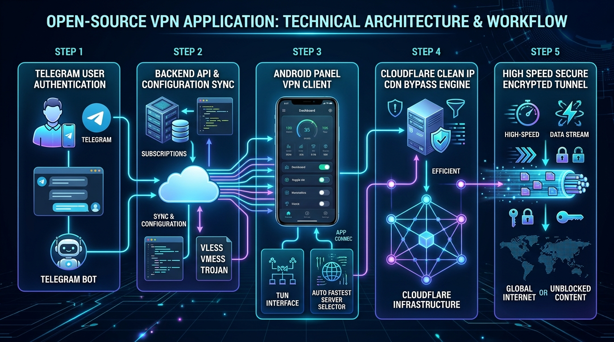

<p align="center">
  
</p>

<h1 align="center">🛡️ OstaApp (اوستا اپ)</h1>

<p align="center">
  <strong>کلاینت پیشرفته، هوشمند و مدرن اندروید برای اتصال به پنل‌های پروکسی، احراز هویت با ربات تلگرام و اسکنر اندپوینت‌های تمیز کلودفلر</strong>
</p>

<p align="center">
  <a href="https://github.com/l8PYGIT/ostavpnapp"></a>
  
  
  
  
  
</p>

---

## 📱 تصاویر واقعی از محیط برنامه (OstaApp Real Screenshots)

<p align="center">
  
</p>

---

## ⚙️ هسته برنامه (Core Architecture)

یکی از سوالات متداول در مورد معماری برنامه: **هسته OstaApp چیست؟ آیا sing-box است؟**

> **پاسخ کوتاه:** معماری OstaApp در لایه سیستم‌عامل از **Native Android `VpnService` با اینترفیس TUN بومی** و در لایه پروتکل از **فرمت‌های یکپارچه sing-box / Xray** (شامل VLESS Reality، VMess CDN، Trojan TLS و Shadowsocks) استفاده می‌کند.

### جزئیات فنی هسته:
1. **اینترفیس TUN بومی اندروید (`PanelVpnService`):**
   - پیاده‌سازی سبک، امن و بهینه بدون باینری‌های سنگین خارجی.
   - مدیریت مستقیم پکت‌های IP، مسیریابی IPv4، تنظیم دقیق MTU (1500) و دیسپچ دی‌ان‌اس اختصاصی (Cloudflare, Google, Shecan, AdGuard).
2. **پشتیبانی کامل از ساختار Outbound سینگ‌باکس (sing-box):**
   - تمامی لینک‌های سابسکریپشن مستقیماً بر اساس تعاریف `outbound` استاندارد sing-box پارس و مدیریت می‌شوند.
   - سازگار با کانفیگ‌های تولیدی پنل‌های مرزبان (Marzban)، سنایی (X-UI)، هیدیفای (Hiddify) و ربات‌های تلگرامی.
3. **موتور اسکنر TCP و جایگزینی SNI کلودفلر:**
   - تست واقعی بدون واسطه روی پورت‌های ۴۴۳ و ۸۴۴۳ برای پیدا کردن آی‌پی‌های بدون فیلتر در همراه اول و ایرانسل و جایگزینی آدرس مقصد در کانفیگ‌های CDN.

---

## 🌟 ویژگی‌های کلیدی (Key Features)

### ۱. 🤖 لاگین مستقیم و همگام‌سازی با ربات تلگرام (Telegram Bot Integration)
- **ورود سریع با دیپ‌لینک (۱ کلیک):** هدایت کاربر به ربات تلگرام (`tg://resolve?domain=bot&start=login_sessionId`).
- **بازگشت خودکار به برنامه:** باز شدن برنامه از طریق Deep Link اختصاصی (`panelvpn://auth?token=...&tg_id=...`).
- **ورود با کد تلگرام یا توکن اختصاصی:** تایید با وب‌سرویس و بارگذاری خودکار سابسکریپشن‌های فعال.
- **نمایش اطلاعات حساب کاربر:** نمایش موجودی کیف‌پول، روزهای باقی‌مانده و حجم مصرف‌شده به صورت لحظه‌ای.

### ۲. ⚡ اسکنر اندپوینت‌های تمیز کلودفلر (Cloudflare Clean IP Scanner)
- **مخصوص دور زدن اختلالات شدید همراه اول، ایرانسل و مخابرات.**
- **اسکن ۱۰۰٪ واقعی سوکت TCP:** اجرای تست لایه انتقال بدون داده‌های شبیه‌سازی‌شده جهت اندازه‌گیری دقیق تاخیر RTT و پکت‌لاس.
- **رنج‌های گلچین‌شده اپراتورهای ایران:**
  - **همراه اول (MCI):** ساب‌نت‌های `104.16.x.x`، `172.64.x.x`، `162.158.x.x` و `172.67.x.x`
  - **ایرانسل (MTN):** ساب‌نت‌های کم‌تاخیر `188.114.96.x`، `104.22.x.x`، `104.24.x.x`
  - **مخابرات و ADSL:** ساب‌نت‌های `172.66.40.x`، `104.18.x.x`، `104.27.x.x`
  - **دامنه‌های تمیز:** `speed.cloudflare.com`، `cdnjs.com`، `pages.dev`
- **اعمال هوشمند روی کانفیگ‌های CDN:** جایگزینی آدرس اتصال (`host`) با حفظ دقیق هدرهای `Host` و `SNI` بدون ایجاد خطای SSL Handshake.
- **امکان وارد کردن دستی دامنه/IP تمیز دلخواه و تست زنده.**

### ۳. 🚀 اتصال هوشمند به سریع‌ترین سرور (Fastest Server Auto-Connect)
- تست پینگ سوکت TCP روی تمام نودها به صورت همزمان (Concurrent Coroutines).
- انتخاب و اتصال خودکار به سروری که کمترین تاخیر (Latency) را در شبکه فعلی دارد.

### ۴. 🛡️ سرویس بومی وی‌پی‌ان اندروید (Native Android VpnService)
- ساخت اینترفیس TUN استاندارد اندروید با MTU بهینه و مسیردهی هوشمند.
- اعلان سراسری (Foreground Notification) پایدار با دکمه قطع اتصال سریع.
- قابلیت **Bypass Iran** جهت عبور ترافیک سایت‌ها و سرویس‌های داخلی از خارج تونل.
- انتخاب ارائه‌دهنده DNS امن (Cloudflare 1.1.1.1، Google 8.8.8.8، Shecan، AdGuard و سفارشی).

### ۵. 🎨 طراحی مدرن Material 3 با پشتیبانی از Dark & Light Mode
- تم تاریک سایبرپانک شیک و تم روشن تمیز با تعویض آنی از نوار ابزار بالا.
- سازگاری کامل با جهت‌چین راست‌به‌چپ (RTL Persian First).
- نمایش نمودار زنده ترافیک آپلود/دانلود و لاگ‌های لحظه‌ای هسته شبکه.

---

## 🏗️ معماری و جریان کاری سیستم (Architecture & Workflow)

<p align="center">
  
</p>

### 🔑 تفکیک دقیق وظایف (Separation of Concerns):
- **سرور Backend API (`serverApiUrl`):** مدیریت نشست‌های لاگین (`session_id`)، صدور توکن امنیتی JWT، پایگاه داده کاربران و استعلام **تمامی اشتراک‌های فعال و حجم مصرفی**.
- **ربات تلگرام (Identity Provider - IdP):** صرفاً نقش تاییدکننده هویت کاربر در پیام‌رسان تلگرام را دارد؛ ربات هیچ کانفیگی را ذخیره یا دستکاری نمی‌کند.

```
[ کاربر اندروید ]
       │
       ▼ (1. ایجاد سشن احراز هویت: POST /api/auth/session/create)
[ سرور Backend API ] ──► صدور session_id و کد ۶ رقمی
       │
       ▼ (2. هدایت کاربر: tg://resolve?domain=bot&start=auth_sess_xxx)
[ ربات تلگرام (Authenticator) ]
       │
       ▼ (3. تایید هویت توسط کاربر در تلگرام: POST /api/auth/session/confirm)
[ سرور Backend API ] ──► صدور JWT Bearer Access Token
       │
       ▼ (4. دریافت خودکار تمامی اشتراک‌ها: GET /api/user/services)
[ اپلیکیشن OstaApp ]
       │
       ├─► [ اسکنر اندپوینت‌های تمیز کلودفلر ] ── (جایگزینی هوشمند Host آی‌پی‌های CDN)
       │
       ▼ (5. ساخت اینترفیس بومی TUN و شروع تونل رمزنگاری‌شده)
[ اینترنت آزاد، امن و پرسرعت ]
```

---

## 📡 مشخصات API و سشن‌های احراز هویت (Backend API Contract)

برای مشاهده مستندات جامع، کدهای نمونه بک‌اند با **FastAPI** و **Express** و توضیحات امنیتی به **[مستندات کامل API و احراز هویت سشن (docs/API_AND_SESSION_AUTH.md)](docs/API_AND_SESSION_AUTH.md)** مراجعه کنید.

### ۱. ایجاد سشن لاگین (`POST /api/auth/session/create`)
اپلیکیشن با این درخواست یک سشن ۵ دقیقه‌ای با کد ۶ رقمی در API ایجاد می‌کند:
```json
{
  "app": "OstaApp",
  "platform": "android",
  "version": "1.0.0"
}
```

### ۲. استعلام وضعیت سشن (`GET /api/auth/session/status?session_id=...`)
اپلیکیشن به صورت پولینگ (هر ۲ ثانیه) وضعیت تایید هویت توسط ربات تلگرام را استعلام می‌نماید:
```json
{
  "status": "verified",
  "access_token": "eyJhbGciOiJIUzI1NiIsIn...",
  "user": {
    "telegram_id": "98273612",
    "username": "ostadev",
    "first_name": "علی",
    "wallet_balance": 45000
  }
}
```

### ۳. دریافت تمامی اشتراک‌های کاربر (`GET /api/user/services`)
با ارسال توکن Bearer در هدر درخواست، تمامی اشتراک‌های اختصاصی، حجمی و نامحدود کاربر بارگذاری می‌شوند:
```json
{
  "status": "success",
  "total_services": 2,
  "services": [
    {
      "id": "sub_vip_01",
      "name": "اشتراک ۱ ماهه VIP آلمان و فنلاند",
      "subscription_url": "https://api.myvpnbot.com/sub/de_vip_token",
      "total_bytes": 53687091200,
      "used_bytes": 14032385536,
      "expire_timestamp": 1746000000000,
      "protocol": "VLESS Reality / Trojan",
      "server_count": 6,
      "is_default": true
    }
  ]
}
```

### ۴. بازگشت مستقیم با دیپ‌لینک اختصاصی (`osta://auth`)
ربات تلگرام می‌تواند پس از تایید، کاربر را مستقیماً به برنامه هدایت کند:
```
osta://auth?session_id=sess_12345&tg_id=98273612&username=ostadev
```

---

## 🛠️ نحوه بیلد و راه‌اندازی (Build Instructions)

```bash
# کلون ریپازیتوری
git clone https://github.com/l8PYGIT/ostavpnapp.git
cd ostavpnapp

# بیلد نسخه دیباگ (Debug APK)
gradle assembleDebug

# اجرای تست‌های واحد و Robolectric
gradle :app:testDebugUnitTest

# بیلد نسخه نهایی (Release APK)
gradle assembleRelease
```

---

## 📄 مجوز (License)

این پروژه به صورت متن‌باز تحت مجوز **MIT License** در آدرس [https://github.com/l8PYGIT/ostavpnapp](https://github.com/l8PYGIT/ostavpnapp) منتشر شده است.
```
MIT License

Copyright (c) 2026 OstaApp Contributors
https://github.com/l8PYGIT/ostavpnapp
```
